# Selection Sort — Visual Walkthrough

## Initial Array

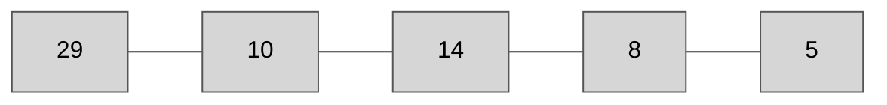

Array: `[29, 10, 14, 8, 5]`

---

## Pass 1 — Find the Smallest

The smallest element is `5`.

Remove it from the array and append it to the new sorted array.

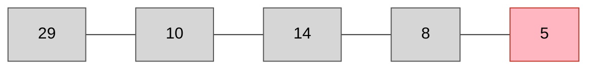

**Remove `5`:**

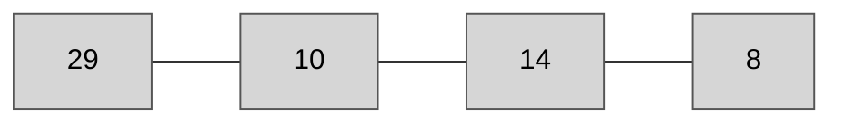

**New array:**

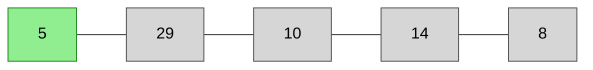

`[5]`

---

## Pass 2 — Find the Next Smallest

Remaining array: `[29, 10, 14, 8]`

The smallest element is `8`.

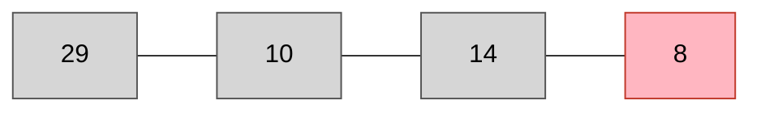

Remove `8` and append it to the new array.

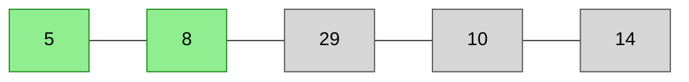

`[5, 8]`

---

## Pass 3 — Find the Next Smallest

Remaining array: `[29, 10, 14]`

The smallest element is `10`.

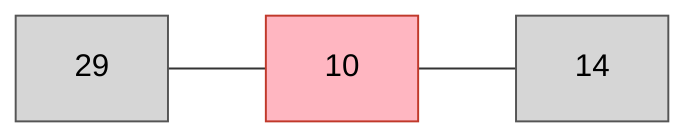

Remove `10` and append it.

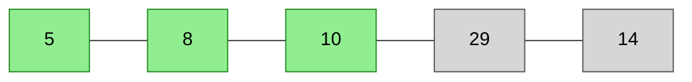

`[5, 8, 10]`

---

## Pass 4 — Final Element

Remaining array: `[29, 14]`

The smallest element is `14`.

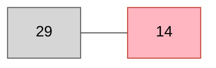

Remove `14` and append it.

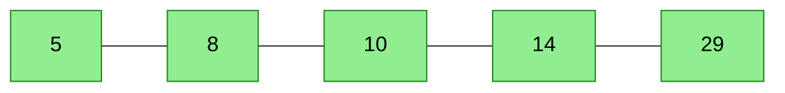

`[5, 8, 10, 14]`

---

## Final Step

Only `29` remains.

Append the final element.

# Final Sorted Array

`[5, 8, 10, 14, 29]`

---

## Algorithm Overview

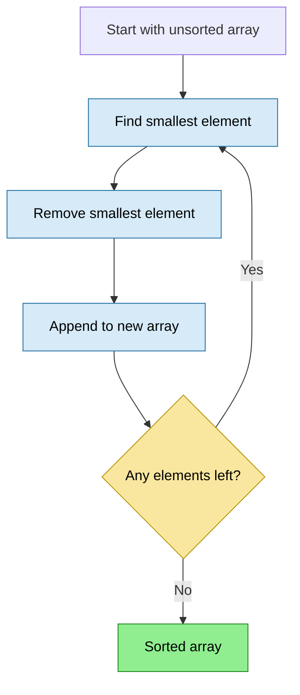

## Complexity

For an array of size `n`:

| Property | Complexity |
|---|---|
| Comparisons | $n(n−1)/2$ |
| Time | $O(n²)$ |
| Space | $O(n)$ — new array implementation |

For `n = 5`:

$$
\frac{5(5-1)}{2} = 10
$$

**10 comparisons** are needed in the standard implementation.
