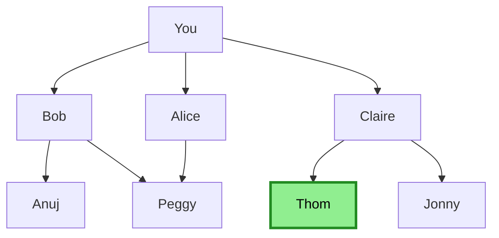
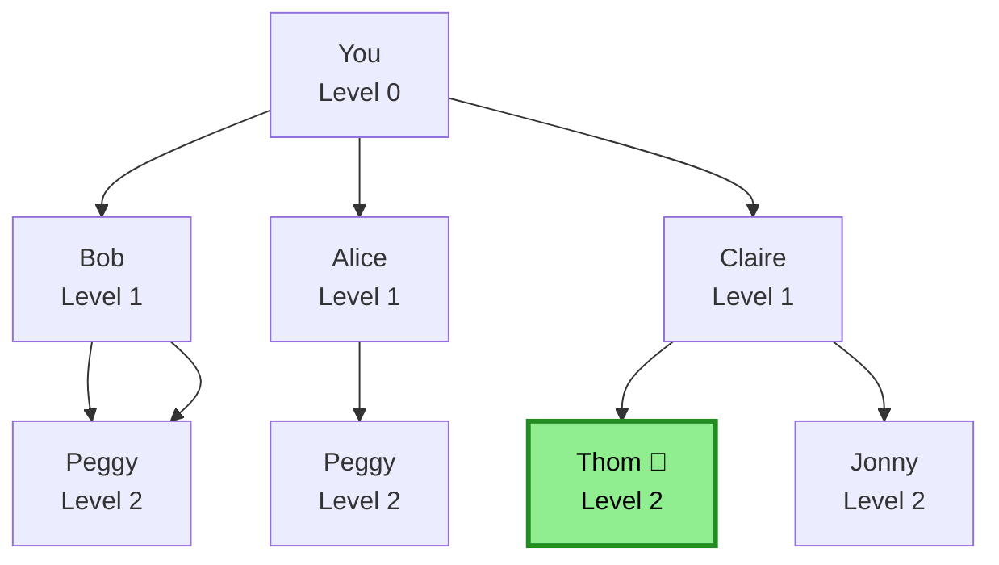
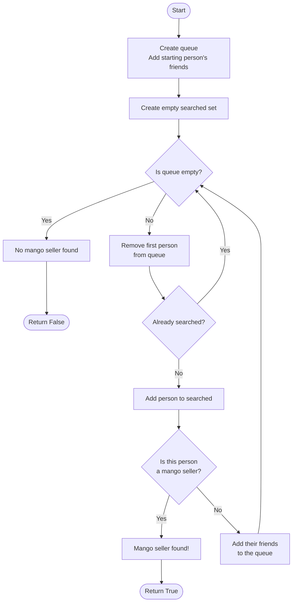
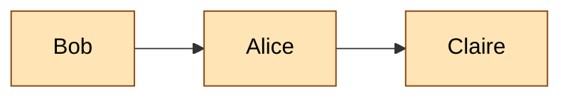
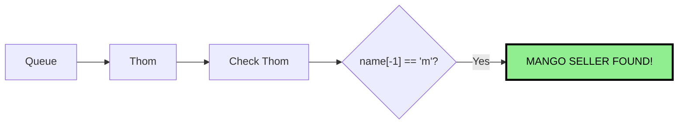
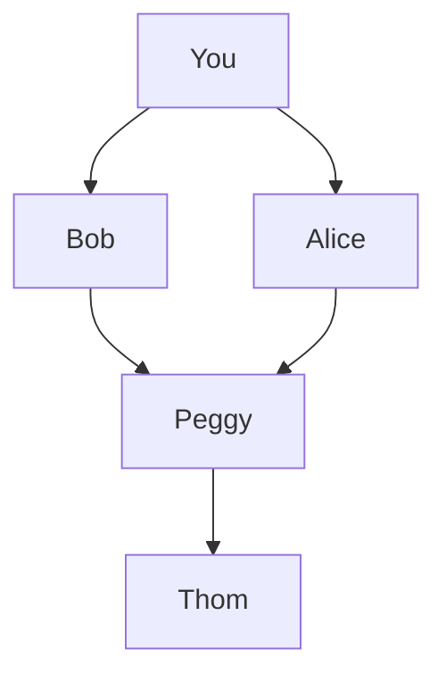
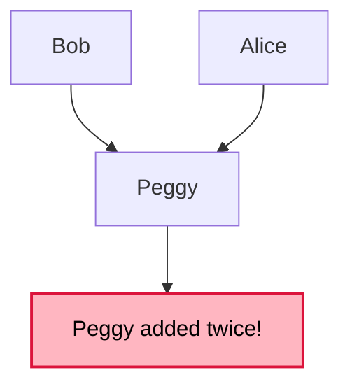
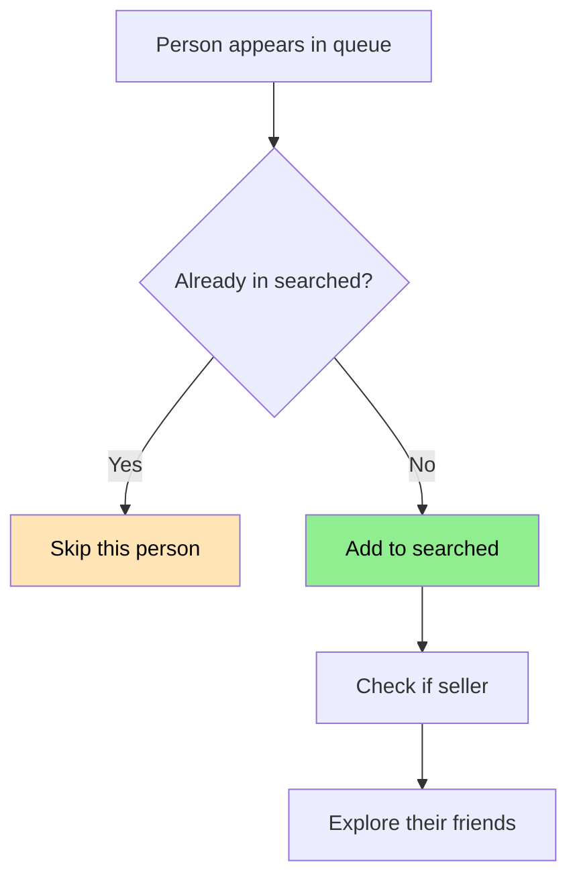
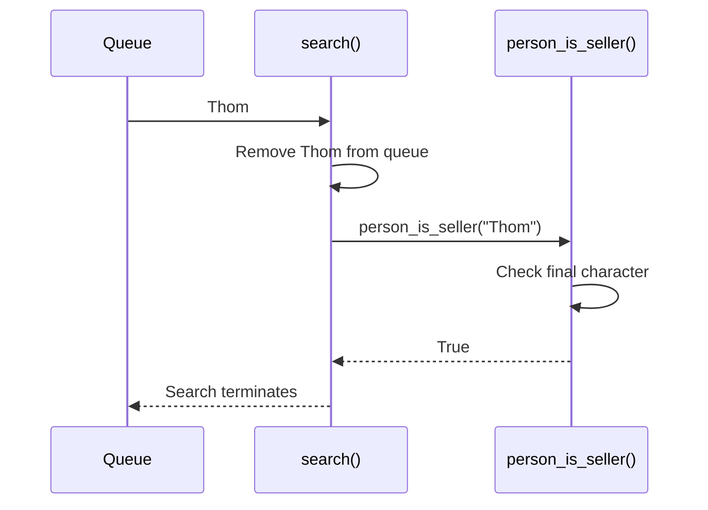
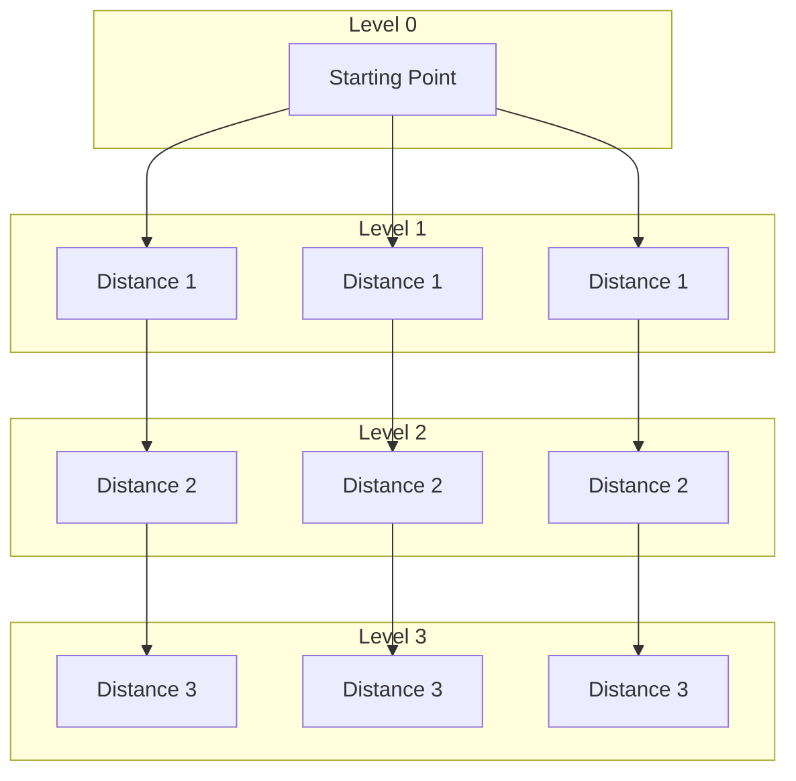

# Breadth-First Search (BFS) — Visual Guide

This document visually explains the Breadth-First Search (BFS) implementation from Chapter 6 of **Grokking Algorithms**.

For the complete code explanation, see [`EXPLANATION.md`](./EXPLANATION.md).

---

## 1. The Social Network Graph

Imagine we are searching for a mango seller among our friends and their friends.

Each person is a node, and each connection represents a person we can contact.



Our goal is to find someone whose name ends with `"m"`.

In our implementation:

```python
def person_is_seller(name):
    return name[-1] == "m"
```

Therefore, **Thom** is our mango seller.

---

## 2. BFS Traversal Levels

BFS explores the network level by level.

It first checks people directly connected to us, then people connected to them, and so on.



### The order of exploration

1. **Level 0:** You
2. **Level 1:** Bob → Alice → Claire
3. **Level 2:** Anuj → Peggy → Thom → Jonny

Because BFS explores level 1 before level 2, it finds the mango seller at the shortest connection distance.

---

## 3. How the Algorithm Works

The following flowchart represents the logic of `breadth_first_search(name)`.



The important idea is that the queue controls **the order in which people are explored**.

---

## 4. Queue State During Execution

A queue follows the **FIFO** principle:

> First In, First Out.

The person who enters the queue first is the person who gets checked first.

Let's follow the queue step by step.

### Initial state

We start by adding You's friends to the queue.



Queue:

```text
[Bob, Alice, Claire]
```

### Step 1 — Check Bob

Bob is removed from the front.

Bob is not a mango seller, so we add Bob's friend Anuj.

```text
Queue before: [Bob, Alice, Claire]
Check: Bob
Queue after:  [Alice, Claire, Anuj]
```

### Step 2 — Check Alice

Alice is removed from the front.

Alice is not a mango seller, so Peggy is added.

```text
Queue before: [Alice, Claire, Anuj]
Check: Alice
Queue after:  [Claire, Anuj, Peggy]
```

### Step 3 — Check Claire

Claire is removed from the front.

Claire is not a mango seller, so Jonny and Thom are added.

```text
Queue before: [Claire, Anuj, Peggy]
Check: Claire
Queue after:  [Anuj, Peggy, Jonny, Thom]
```

### Step 4 — Check Anuj

Anuj is removed from the front.

Anuj is not a mango seller and has no additional friends in our graph.

```text
Queue before: [Anuj, Peggy, Jonny, Thom]
Check: Anuj
Queue after:  [Peggy, Jonny, Thom]
```

### Step 5 — Check Peggy

Peggy is removed from the front.

Peggy is not a mango seller.

```text
Queue before: [Peggy, Jonny, Thom]
Check: Peggy
Queue after:  [Jonny, Thom]
```

### Step 6 — Check Jonny

Jonny is removed from the front.

Jonny is not a mango seller.

```text
Queue before: [Jonny, Thom]
Check: Jonny
Queue after:  [Thom]
```

### Step 7 — Check Thom 🍋

Thom is removed from the front.



```python
person_is_seller("Thom")
```

Returns:

```python
True
```

The search terminates immediately.

---

## 5. Complete Dry Run

| Step | Person Checked | Queue After Checking | Searched Set | Seller? |
|------|----------------|---------------------|---------------|---------|
| 0 | — | Bob, Alice, Claire | `{}` | — |
| 1 | Bob | Alice, Claire, Anuj | `{Bob}` | No |
| 2 | Alice | Claire, Anuj, Peggy | `{Bob, Alice}` | No |
| 3 | Claire | Anuj, Peggy, Jonny, Thom | `{Bob, Alice, Claire}` | No |
| 4 | Anuj | Peggy, Jonny, Thom | `{Bob, Alice, Claire, Anuj}` | No |
| 5 | Peggy | Jonny, Thom | `{Bob, Alice, Claire, Anuj, Peggy}` | No |
| 6 | Jonny | Thom | `{Bob, Alice, Claire, Anuj, Peggy, Jonny}` | No |
| 7 | **Thom** | — | `{Bob, Alice, Claire, Anuj, Peggy, Jonny, Thom}` | **YES!** |

The search stops at Step 7.

---

## 6. Why Do We Need the `searched` Set?

Imagine two different people have a connection to the same person.

For example:



Both Bob and Alice know Peggy.

Without a `searched` set, Peggy could be added to the queue multiple times.



This creates unnecessary work.

Our implementation prevents this using:

```python
searched = set()
```

Before processing someone:

```python
if person not in searched:
    searched.add(person)
```

Once Peggy is added to `searched`, we know that she has already been examined.

### The protection mechanism



The `searched` set ensures that every person is processed **at most once**.

---

## 7. The Moment Thom Is Found

Let's zoom in on the final moment.



The function returns:

```python
True
```

No further people are checked.

---

## 8. The Core Idea of BFS

BFS is not simply about searching through a graph.

It is about searching **in order of increasing distance from the starting node**.



### Remember

- **Queue:** Determines who gets explored next.
- **BFS:** Explores nearby nodes before distant nodes.
- **`searched`:** Prevents duplicate processing.
- **Seller check:** Determines whether the current person satisfies our goal.
- **Early termination:** Stops the search as soon as the seller is found.

In one sentence:

> **Breadth-First Search explores a graph level by level using a queue, allowing it to find the closest matching node first.**

---

## Related Files

- [`EXPLANATION.md`](./EXPLANATION.md) — Detailed explanation of the implementation.
- [`BFS_VISUALIZATION.md`](./BFS_VISUALIZATION.md) — Visual representation of BFS using Mermaid diagrams.
